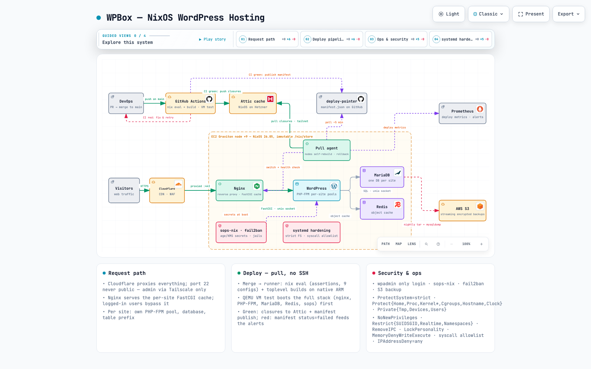

# wpbox

Multi-tenant WordPress hosting on NixOS: immutable fleet, pull-based deploys, atomic rollback.

Interactive architecture diagram: **[marcothedood.github.io/wpbox](https://marcothedood.github.io/wpbox)**

## What it is

A hosting platform that runs ~40 production WordPress sites on a fleet of NixOS machines. The whole stack, from PHP-FPM pools to firewall rules, is declared in Nix and built in CI. Nodes never get SSH deploys: they pull signed closures from a binary cache and switch atomically, with automatic rollback if the new configuration fails its health check.

## Architecture

Explore the [interactive version](https://marcothedood.github.io/wpbox) for guided views of the request path, deploy pipeline and security model.

Request path: Cloudflare (CDN and WAF, proxied on 443) fronts Nginx, which reverse proxies to per-site PHP-FPM pools with a FastCGI cache. Each site gets its own MariaDB database over a unix socket and a Redis object cache.

## Deploy pipeline

1. Every PR triggers GitHub Actions: nix eval, full build, NixOS VM integration tests.
2. Green CI pushes closures to an Attic binary cache and publishes a deploy manifest (manifest.json) to a deploy-pointer repo. Red CI: fix and retry.
3. Each node runs a pull agent that polls the manifest every ~5 minutes, fetches closures from the cache over Tailscale, switches to the new configuration atomically, runs a health check and rolls back on failure.
4. Deploy metrics land in Prometheus, with alerts on failed deploys.

## Security model

- Secrets managed with sops-nix (age plus AWS KMS), decrypted at boot.
- systemd hardening on every service: strict filesystem rules and a syscall allowlist.
- fail2ban jails.
- Immutable /nix/store, no mutable system state outside declared paths.

## Backups and observability

- Nightly tar plus mysqldump per site, streamed encrypted to AWS S3.
- Prometheus metrics for deploys and services, alerting on failures.

## Numbers

| Metric | Value |
|---|---|
| Production WordPress sites | ~40 |
| Domains | 100+ |
| Nodes | 9 EC2 Graviton (ARM64), NixOS |
| Deploy method | Pull-based, atomic switch, auto rollback |

## Status

In production at my employer since 2023. The architecture and the interactive diagram are published here; the code itself is private.
